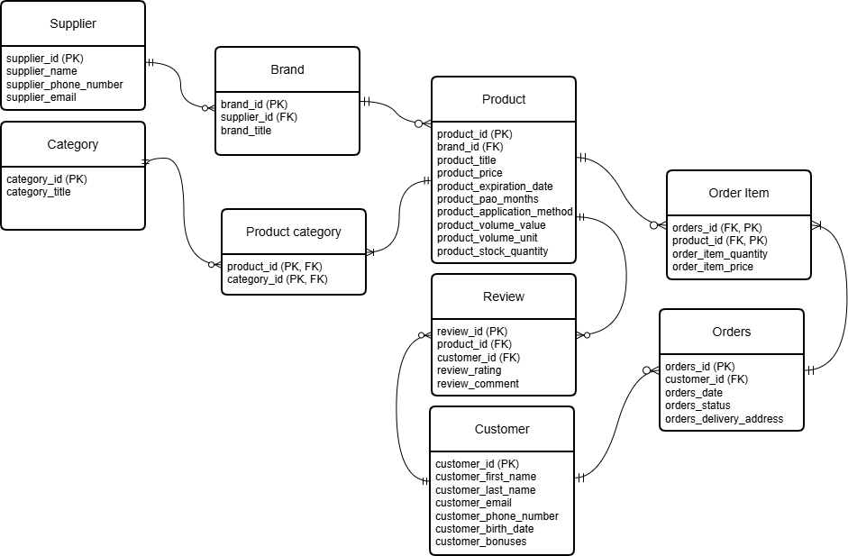

## Діаграма сутність-зв'язок (ERD):

## Опис таблиць:

### Таблиця: `supplier`

**Призначення:** Зберігає інформацію про постачальників брендів товарів

**Стовпці:**
| Стовпець | Тип | Обмеження | Опис |
|----------|-----|-----------|------|
| supplier_id | SERIAL | PRIMARY KEY | Ідентифікатор постачальника |
| supplier_name | VARCHAR(100) | UNIQUE, NOT NULL | Назва постачальника |
| supplier_phone_number | VARCHAR(16) | UNIQUE, NOT NULL | Номер телефону постачальника |
| supplier_email | VARCHAR(254) | UNIQUE, NOT NULL | Email постачальника |

**Зв'язки:**
- Один-до-багатьох з `brand` (один постачальник може постачати кілька брендів)

### Таблиця: `brand`

**Призначення:** Зберігає інформацію про бренди товарів

**Стовпці:**
| Стовпець | Тип | Обмеження | Опис |
|----------|-----|-----------|------|
| brand_id | SERIAL | PRIMARY KEY | Ідентифікатор бренду |
| supplier_id | INTEGER | FOREIGN KEY, NOT NULL | Ідентифікатор постачальника |
| brand_title | VARCHAR(100) | UNIQUE, NOT NULL | Назва бренду |

**Зв'язки:**
- Багато-до-одного з `supplier` (кілька брендів можуть бути пов'язані з одним постачальником)
- Один-до-багатьох з `product` (один бренд може мати кілька товарів)

### Таблиця: `category`

**Призначення:** Зберігає інформацію про категорії товарів

**Стовпці:**
| Стовпець | Тип | Обмеження | Опис |
|----------|-----|-----------|------|
| category_id | SERIAL | PRIMARY KEY | Ідентифікатор категорії |
| category_title | VARCHAR(100) | UNIQUE, NOT NULL | Назва категорії |

**Зв'язки:**
- Один-до-багатьох з `product_category` (одна категорія може мати кілька записів асоціативної сутності product_category). Через цей зв'язок відбувається реалізація зв'язку Багато-до-багатьох з `product`

### Таблиця: `product`

**Призначення:** Зберігає інформацію про товари

**Стовпці:**
| Стовпець | Тип | Обмеження | Опис |
|----------|-----|-----------|------|
| product_id | SERIAL | PRIMARY KEY | Ідентифікатор товару |
| brand_id | INTEGER | FOREIGN KEY, NOT NULL | Ідентифікатор бренду |
| product_title | VARCHAR(150) | NOT NULL | Назва товару |
| product_price | DECIMAL(8, 2) | NOT NULL, CHECK (product_price > 0) | Ціна товару |
| product_expiration_date | DATE | NULL | Дата закінчення терміну придатності товару |
| product_pao_months | SMALLINT | NULL, CHECK (product_pao_months > 0) | Tермін придатності товару в місяцях після відкриття упаковки |
| product_volume_value | INTEGER | NOT NULL, CHECK (product_volume_value > 0) | Числове значення об'єму, ваги або кількості товару |
| product_volume_unit | ENUM (product_volume_unit) | NOT NULL | Одиниця вимірювання товару (ml, g або pcs) |
| product_application_method | TEXT | NULL | Опис способу застосування товару |
| product_stock_quantity | INTEGER | NOT NULL, DEFAULT 0, CHECK (product_stock_quantity >= 0) | Кількість товару на складі |

**Індекси:**
- `product_brand_id_idx` на `brand_id` (для пошуку товарів за брендом)
- `product_product_price_idx` на `product_price` (для фільтрації товарів за ціною)

**Зв'язки:**
- Багато-до-одного з `brand` (кілька товарів можуть бути пов'язані з одним брендом)
- Один-до-багатьох з `product_category` (один товар може мати кілька записів асоціативної сутності product_category). Через цей зв'язок відбувається реалізація зв'язку Багато-до-багатьох з `category`
- Один-до-багатьох з `review` (один товар може мати кілька відгуків)
- Один-до-багатьох з `order_item` (один товар може належати багатьом позиціям замовлення)

### Таблиця: `customer`

**Призначення:** Зберігає інформацію про клієнтів 

**Стовпці:**
| Стовпець | Тип | Обмеження | Опис |
|----------|-----|-----------|------|
| customer_id | SERIAL | PRIMARY KEY | Ідентифікатор клієнта |
| customer_first_name | VARCHAR(100) | NOT NULL | Ім'я клієнта |
| customer_last_name | VARCHAR(100) | NOT NULL | Прізвище клієнта |
| customer_email | VARCHAR(254) | UNIQUE, NOT NULL | Email клієнта |
| customer_phone_number | VARCHAR(16) | UNIQUE, NOT NULL | Номер телефону клієнта |
| customer_birth_date | DATE | NOT NULL | Дата народження клієнта |
| customer_bonuses | INTEGER | NOT NULL, DEFAULT 0, CHECK (customer_bonuses >= 0) | Кількість бонусів клієнта |

**Зв'язки:**
- Один-до-багатьох з `orders` (один клієнт може мати кілька замовлень)
- Один-до-багатьох з `review` (один клієнт може залишити кілька відгуків)

### Таблиця: `orders`

**Призначення:** Зберігає інформацію про замовлення 

**Стовпці:**
| Стовпець | Тип | Обмеження | Опис |
|----------|-----|-----------|------|
| orders_id | SERIAL | PRIMARY KEY | Ідентифікатор замовлення |
| customer_id | INTEGER | FOREIGN KEY, NOT NULL | Ідентифікатор клієнта |
| orders_date | TIMESTAMP(6) | NOT NULL, DEFAULT CURRENT_TIMESTAMP | Дата створення замовлення |
| orders_status | ENUM (order_status_type) | NOT NULL, DEFAULT 'New' | Статус замовлення |
| orders_delivery_address | TEXT | NOT NULL | Адреса доставки замовлення |

**Індекси:**
- `orders_customer_id_orders_date_idx` на `customer_id, orders_date` (для пошуку замовлення конкретного клієнта за датою його створення)  

**Зв'язки:**
- Багато-до-одного з `customer` (кілька замовлень можуть належати одному клієнту)
- Один-до-багатьох з `order_item` (одне замовлення може містити кілька елементів замовлення)

### Таблиця: `order_item`

**Призначення:** Зберігає інформацію про елементи замовлення

**Стовпці:**
| Стовпець | Тип | Обмеження | Опис |
|----------|-----|-----------|------|
| orders_id | INTEGER | NOT NULL, FOREIGN KEY, частина складеного PRIMARY KEY | Ідентифікатор замовлення |
| product_id | INTEGER | NOT NULL, FOREIGN KEY, частина складеного PRIMARY KEY | Ідентифікатор товару |
| order_item_quantity | INTEGER | NOT NULL, CHECK (order_item_quantity > 0) | Кількість певних товарів у замовленні |
| order_item_price | DECIMAL(8, 2) | NOT NULL, CHECK (order_item_price > 0) | Ціна товару на момент оформлення замовлення |

**Складений первинний ключ:** `(orders_id, product_id)`

**Зв'язки:**
- Багато-до-одного з `orders` (кілька елементів замовлення можуть належати одному замовленню)
- Багато-до-одного з `product` (кілька елементів замовлення можуть належати одному товару)

### Таблиця: `product_category`

**Призначення:** Зберігає інформацію про приналежність товарів до категорій

**Стовпці:**
| Стовпець | Тип | Обмеження | Опис |
|----------|-----|-----------|------|
| product_id | INTEGER | NOT NULL, FOREIGN KEY, частина складеного PRIMARY KEY | Ідентифікатор товару |
| category_id | INTEGER | NOT NULL, FOREIGN KEY, частина складеного PRIMARY KEY | Ідентифікатор категорії |

**Складений первинний ключ:** `(product_id, category_id)`

**Індекси:**
- `product_category_category_id_idx` на `category_id` (для пошуку товару за його категорією)  

**Зв'язки:**
- Багато-до-одного з `category` (кілька записів асоціативної сутності product_category можуть належати одній категорії)
- Багато-до-одного з `product` (кілька записів асоціативної сутності product_category можуть належати одному товару)

### Таблиця: `review`

**Призначення:** Зберігає інформацію про відгуки на товари

**Стовпці:**
| Стовпець | Тип | Обмеження | Опис |
|----------|-----|-----------|------|
| review_id | SERIAL | PRIMARY KEY | Ідентифікатор відгука |
| product_id | INTEGER | FOREIGN KEY, NOT NULL | Ідентифікатор товару |
| customer_id | INTEGER | FOREIGN KEY, NOT NULL | Ідентифікатор клієнта |
| review_rating | INTEGER | NOT NULL, CHECK (review_rating BETWEEN 1 AND 5) | Рейтинг відгуку на товар |
| review_comment | TEXT | NULL | Коментар до відгуку на товар|

**Індекси:**
- `review_product_id_idx` на `product_id` (для пошуку відгуків за товарами) 

**Індекс для унікальності:**
- `review_customer_id_product_id_key` на `customer_id, product_id` (один клієнт може залишити лише один відгук на конкретний товар).

**Зв'язки:**
- Багато-до-одного з `customer` (кілька відгуків можуть належати одному клієнту)
- Багато-до-одного з `product` (кілька відгуків можуть належати одному товару)